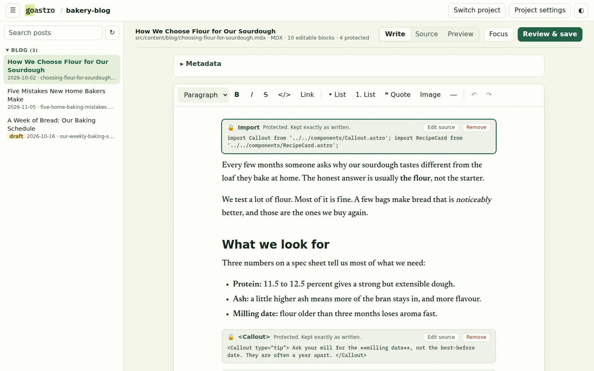
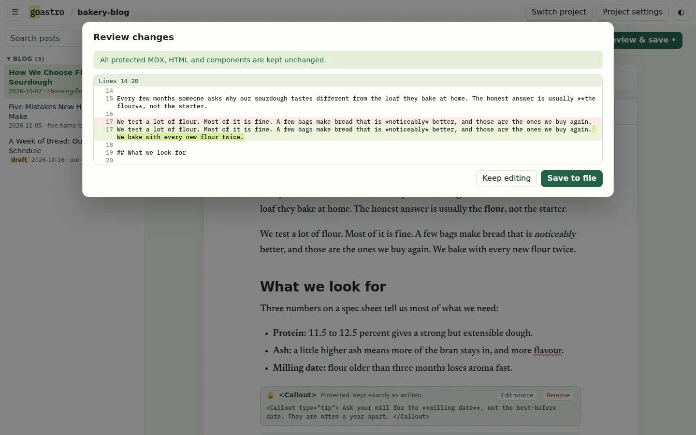
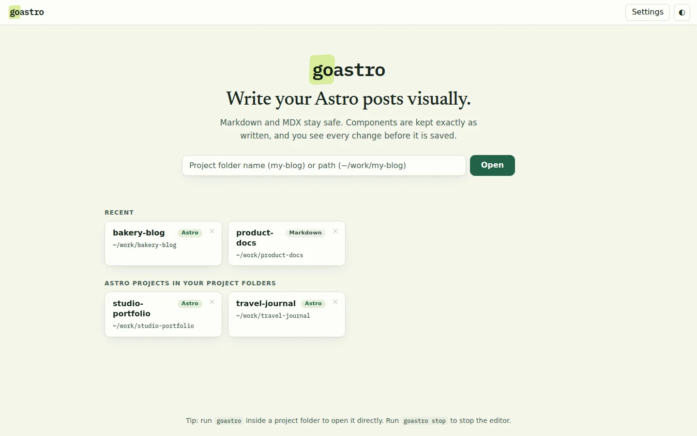
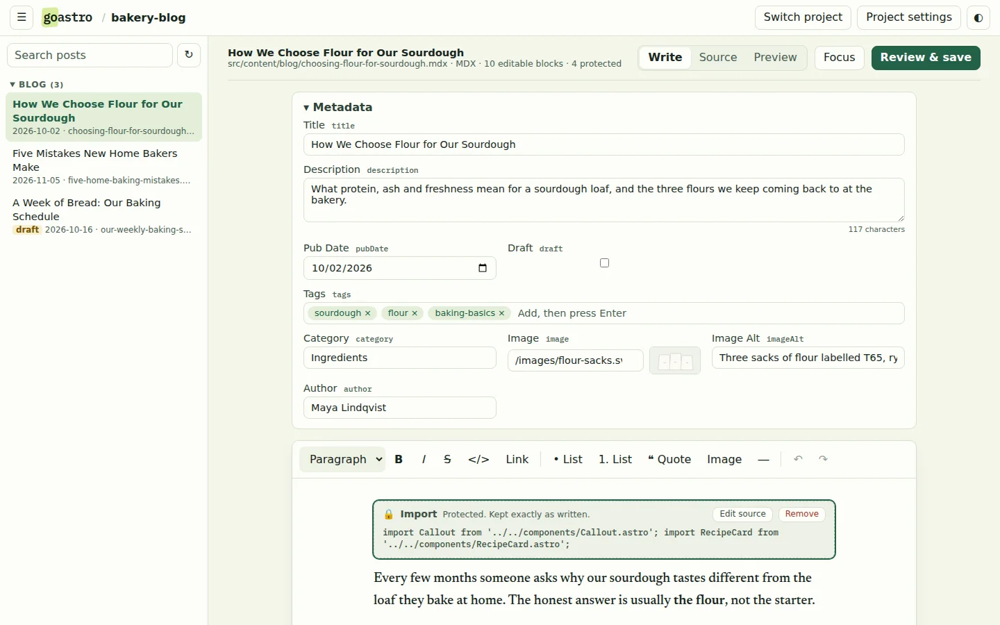
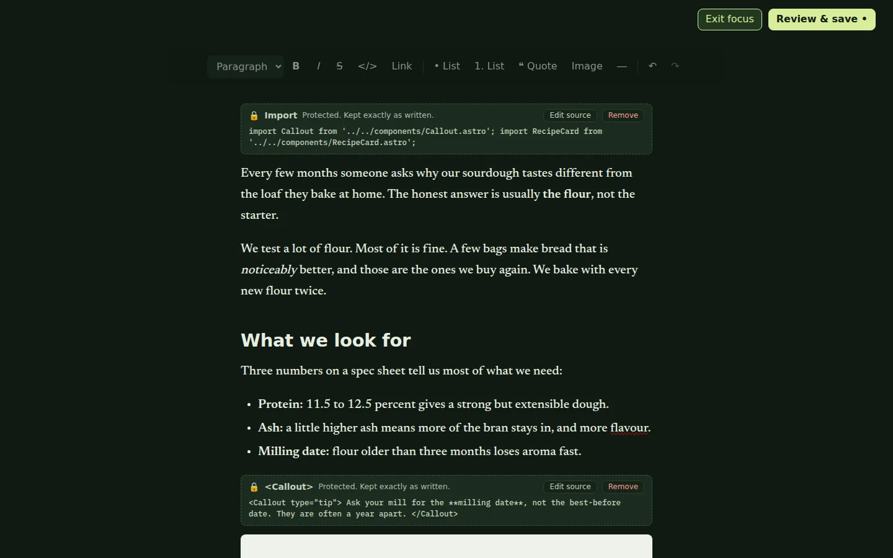
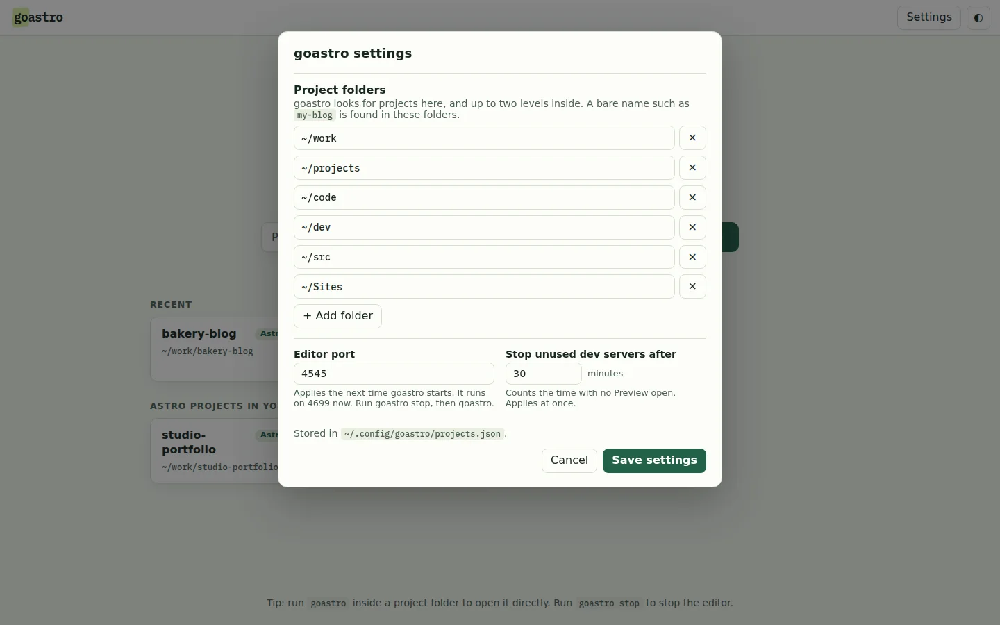

<h1 align="center">
  <picture>
    <source media="(prefers-color-scheme: dark)" srcset="https://raw.githubusercontent.com/kashaziz/goastro/main/docs/images/wordmark-dark.png">
    
  </picture>
</h1>

<p align="center"><strong>goastro: an open-source Markdown and MDX editor for Astro projects</strong></p>

<p align="center">
  <a href="https://www.npmjs.com/package/@goastro/goastro"></a>
  <a href="https://github.com/kashaziz/goastro/blob/main/LICENSE"></a>
</p>



goastro is a local visual editor for the Markdown (`.md`) and MDX (`.mdx`) content of Astro sites. You edit text the way you do in a word processor, and you never see Markdown syntax. MDX components, imports and HTML are protected, so an edit cannot break them.

It is built for Astro, and it works with any folder of Markdown or MDX files.

- **Visual editing:** headings, bold, italic, links, lists, quotes and images, with browser spell check.
- **Frontmatter as a form:** title, description, dates, tags and images in form fields.
- **Safe saves:** a line-by-line diff before every save, and a backup of every file you change.
- **Live preview:** goastro starts your dev server when you need it, and stops it afterwards.
- **Focus mode and dark mode** for long writing sessions.

goastro runs only on your computer. It does not publish, deploy or run Git commands.

## Quick start

Node.js 22.18 or later is required.

Try it in your Astro project, with nothing to install:

```bash
cd ~/work/my-astro-site
npx @goastro/goastro
```

For everyday use, install it once. Then the `goastro` command works in any folder:

```bash
npm install --global @goastro/goastro
goastro
```

Your browser opens with the project loaded. Click a post on the left and start writing. Click **Review & save** (or press Ctrl+S) to see the changes, then **Save to file**.

| Command | What it does |
|---|---|
| `goastro` | Opens the Astro project you are in. Elsewhere, it opens the current folder if it has Markdown files, or else the home page. |
| `goastro my-blog` | Opens a project by name, found in your project folders. |
| `goastro ~/path/to/site` | Opens a project by path. |
| `goastro stop` | Stops goastro and every dev server it started. |
| `goastro --help` | Shows all options. |

Want to try it first? Clone this repository and run `goastro examples/demo-blog`.

## How your content stays safe

1. goastro splits each file into blocks. A block is editable only if it converts to the editor and back without any change. Everything else, such as components, imports, HTML and tables, becomes a **protected block** that is kept exactly as written.
2. When you save, every block you did not change is copied from the original file, byte for byte.
3. Before saving, goastro shows a diff. It warns you if protected content would change, or if the new file would not parse.
4. goastro refuses to save if the file changed on disk after you opened it, and it backs up the old file first.



## Screenshots

| Home page | Metadata form |
|---|---|
|  |  |
| **Focus mode (dark)** | **Settings** |
|  |  |

## Documentation

- [Getting started](https://github.com/kashaziz/goastro/blob/main/docs/getting-started.md)
- [Writing and saving](https://github.com/kashaziz/goastro/blob/main/docs/writing-and-saving.md)
- [Projects and settings](https://github.com/kashaziz/goastro/blob/main/docs/projects-and-settings.md): project folders, the home page, and what Project settings mean
- [Preview and dev servers](https://github.com/kashaziz/goastro/blob/main/docs/preview-and-dev-servers.md)
- [How goastro keeps MDX safe](https://github.com/kashaziz/goastro/blob/main/docs/mdx-safety.md), and its limitations
- [Other Markdown folders](https://github.com/kashaziz/goastro/blob/main/docs/other-markdown-folders.md): Docusaurus, Hugo, Jekyll and plain folders
- [Troubleshooting](https://github.com/kashaziz/goastro/blob/main/docs/troubleshooting.md)
- [Security](https://github.com/kashaziz/goastro/blob/main/SECURITY.md)
- [Development](https://github.com/kashaziz/goastro/blob/main/docs/development.md)

## Platforms

goastro is tested on Linux and on Windows with WSL. macOS should work. Native Windows (outside WSL) is not tested yet. Reports are welcome.

## License

[MIT](https://github.com/kashaziz/goastro/blob/main/LICENSE) © [Kashif Aziz](https://kashifaziz.me)
