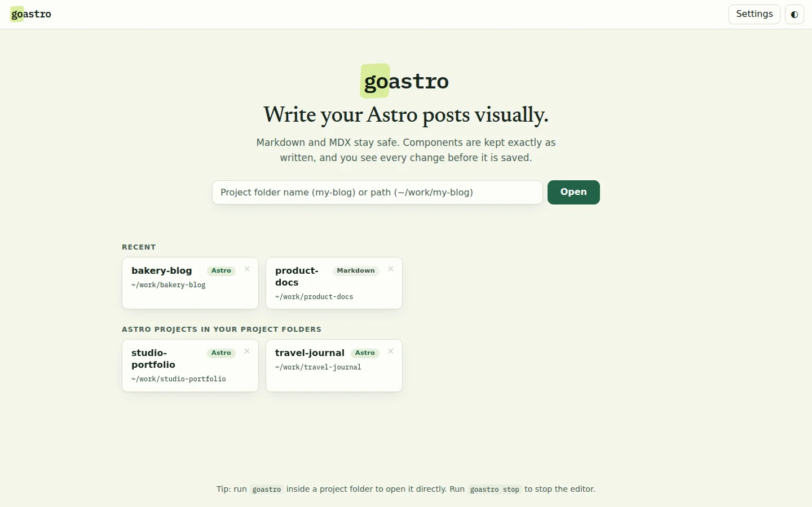
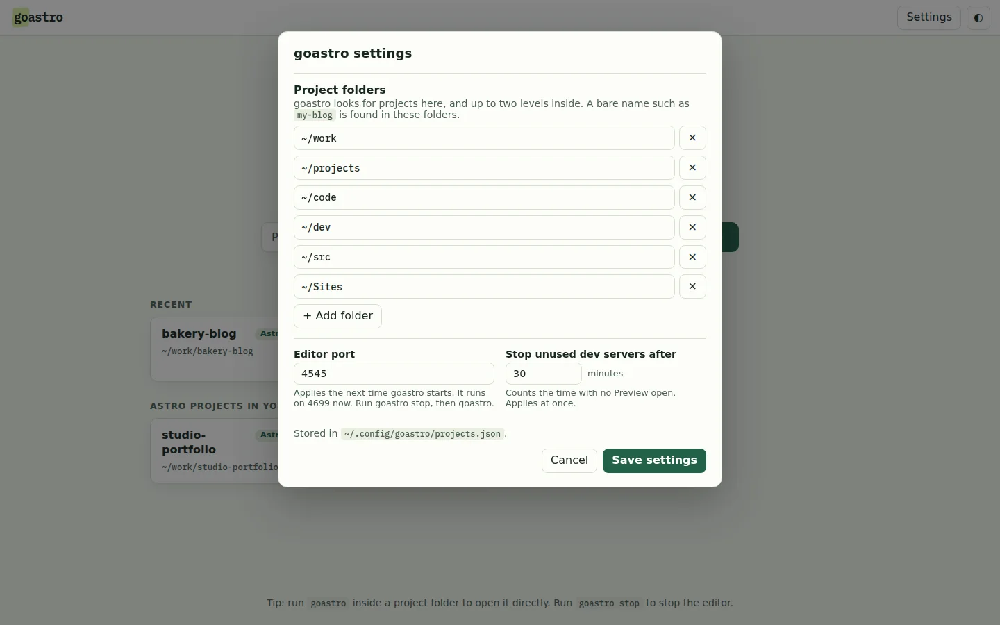

# Projects and settings

## The home page

When you run `goastro` outside a project, or click the goastro logo, you see the home page.

- **Recent** lists the last 12 projects you opened.
- **Astro projects in your project folders** lists every Astro project that goastro finds in your [project folders](#project-folders).
- Type a folder name or path in the box and click **Open** to open any project.

**Remove a card:** hover over it and click the **×**. The project on disk does not change. If you open it again later, it comes back. To show all removed projects again, open **Settings** and click **Show them again** under *Hidden projects*.

## Project folders

Project folders are the places where goastro looks for your projects. goastro uses them in two ways:

1. **`goastro my-blog`:** goastro first checks for a `my-blog` folder in the current folder. Then it looks in each project folder, and one level deeper. For example, it finds `~/work/my-blog` and `~/work/client-a/my-blog`. Only folders that are projects (Astro, or with Markdown files) count.
2. **The home page:** goastro lists the Astro projects it finds in the same places.

When you run `goastro` inside a project, or give a full path, the project folders are not used.

The defaults are `~/work`, `~/projects`, `~/code`, `~/dev`, `~/src` and `~/Sites`. Folders that do not exist are skipped.

## goastro settings

Click **Settings** on the home page.

| Setting | Default | Meaning |
|---|---|---|
| Project folders | see above | Where goastro looks for projects. |
| Editor port | 4545 | The local port of goastro. Applies the next time goastro starts. |
| Stop unused dev servers after | 30 minutes | goastro stops a dev server it started when Preview has not been used for this long. Applies at once. (With no goastro tab open at all, goastro stops it after 3 minutes.) |

Environment variables override the saved values:

| Variable | Example |
|---|---|
| `GOASTRO_PROJECTS_DIRS` | `~/work:~/clients` (use `;` on Windows) |
| `GOASTRO_PORT` | `5000` |
| `GOASTRO_DEV_IDLE_MINUTES` | `60` |
| `GOASTRO_NO_OPEN` | `1` (never open the browser) |

## Project settings

Each project has its own settings. goastro **detects them the first time you open the project**, so you normally do not need to change anything. Click **Project settings** in the top bar to check them.

| Setting | Where it comes from | What it does |
|---|---|---|
| **Dev server address** | Astro's default, `http://localhost:4321` | Preview uses it when *you* start the dev server yourself. When goastro starts the dev server, it uses the real port automatically. |
| **Content folders** | Each folder in `src/content/` that holds `.md` or `.mdx` files, plus Markdown pages in `src/pages/` | Each folder is one group in the post list. |
| **Page URL pattern** | Your `src/pages/**/[slug].astro` routes that call `getCollection('name')` | Builds the Preview address for each post, for example `/blog/{slug}/`. |
| **Fields** | The frontmatter of up to 60 posts in that folder | These become the Metadata form. The type decides the input: text box, date picker, tags, checkbox and so on. |

Change them only if something looks wrong, for example a field with the wrong type, or a URL pattern that does not match your site. **Re-detect** replaces them with freshly detected values.

### URL pattern tokens

| Token | Becomes |
|---|---|
| `{slug}` | The frontmatter `slug`, or else the file name |
| `{id}` | The file path inside the content folder, without the extension |
| Any frontmatter key | For example `{category}` |

### Field types

`text`, `textarea`, `date`, `tags`, `boolean`, `number`, `image`, `select` (enter the choices separated by commas), `yaml` (raw YAML for nested values).

## Where goastro keeps its files

| What | Where |
|---|---|
| Settings and project settings | `~/.config/goastro/projects.json` |
| Backups | `~/.local/state/goastro/backups/` |
| Dev server records | `~/.local/state/goastro/dev-servers.json` |

goastro writes nothing to your project except the content files you save.
