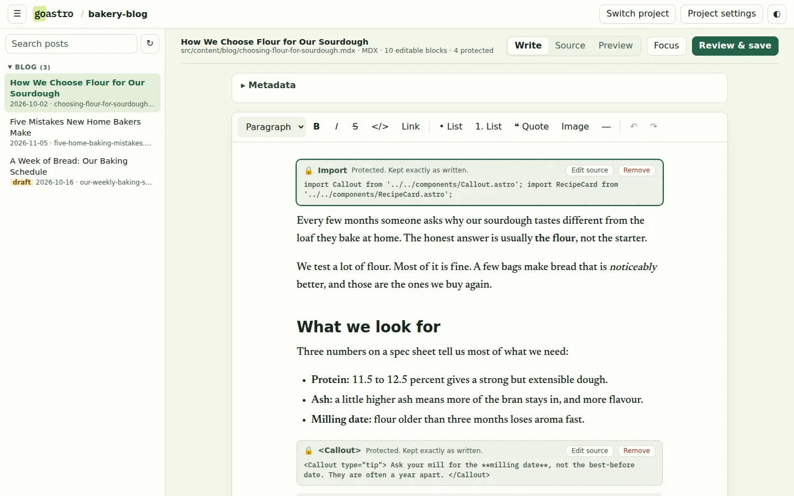
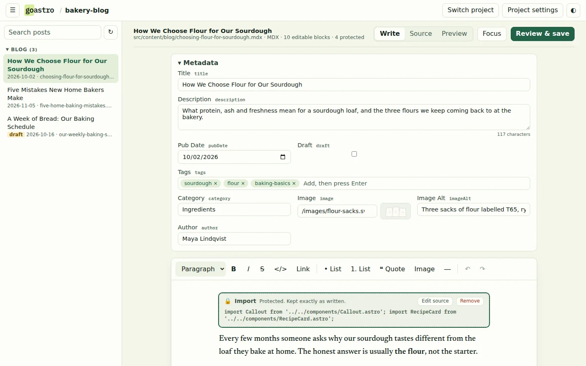
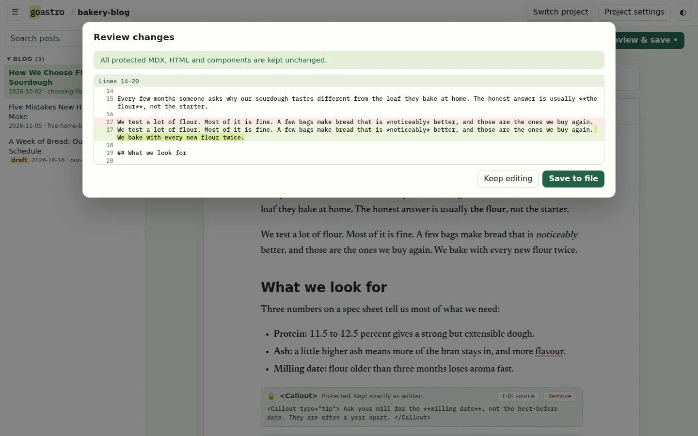
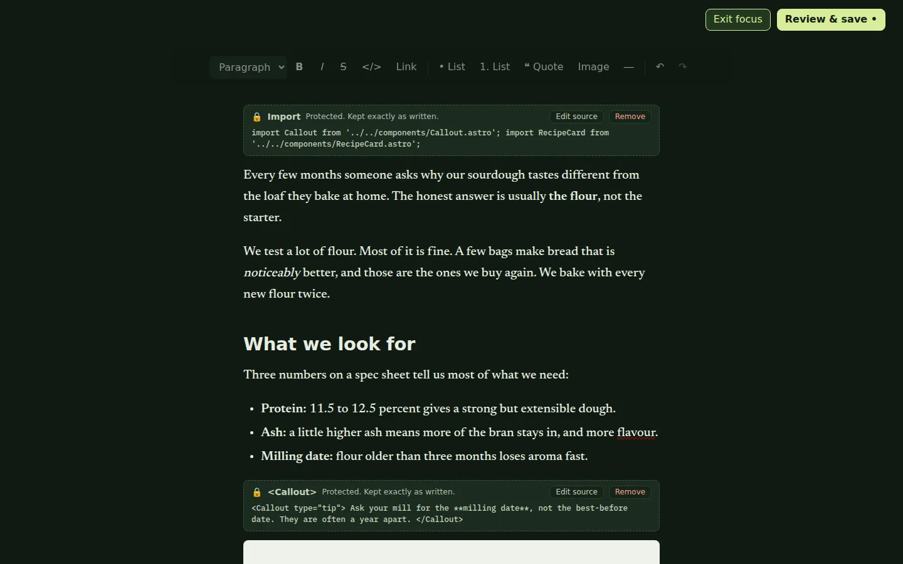

# Writing and saving

## The three views

| View | Use it for |
|---|---|
| **Write** | Normal editing. Text looks like the published page. |
| **Source** | The whole file as plain text, including frontmatter. For advanced MDX. |
| **Preview** | The real page from your Astro dev server. See [Preview and dev servers](preview-and-dev-servers.md). |

Your edits move with you between Write and Source. Preview always shows the **saved** file, so save first to see your latest changes.

## The toolbar

Text style (paragraph, heading 1 to 4), bold, italic, strikethrough, inline code, link, bullet list, numbered list, quote, image, horizontal line, undo and redo.

Your browser's spell check works in Write view.

## Metadata (frontmatter)

Click **Metadata** above the text to open the form. Each field matches a frontmatter key, such as `title` or `pubDate`. The input matches the type: text, long text, date, tags, checkbox, number, image, a fixed list, or raw YAML.

- goastro changes only the values you edit. YAML comments, key order and quote style stay as they were.
- Keys that are not in the form stay as they are. Add them in [Project settings](projects-and-settings.md#project-settings), or edit them in Source view.
- goastro remembers whether the panel is open or closed.

## Protected blocks

Some content cannot be edited visually without risk: MDX components, imports, HTML, tables and code blocks. goastro shows these as **protected blocks**, with a lock and their source in a grey box.

- **Edit source** lets you change the source on purpose.
- **Remove** deletes the block. You get a warning before saving.
- Small MDX parts inside a sentence, such as `<Badge />` or `{year}`, appear as grey chips. Double-click a chip to edit it.

Read more in [How goastro keeps MDX safe](mdx-safety.md).

## Images

Click **Image** in the toolbar and choose a path. Paths that start with `/` come from the project's `public/` folder. Double-click an image in the text to change its path or alt text.

goastro uses image paths only. It does not upload or copy image files.

## Review and save

**Review & save** (or Ctrl+S) shows a line-by-line diff of the file.

- A green note confirms that all protected content is unchanged.
- A red warning appears if protected content would be removed or changed, or if the new file would not parse. You must tick a box to save anyway.
- If the file changed on disk after you opened it, for example in another editor, goastro refuses to save. Reload the file first.

Before each save, goastro copies the old file to `~/.local/state/goastro/backups/<project>/<time>/`.

## Focus mode

Click **Focus** to hide everything except your text and the toolbar. Press Esc or click **Exit focus** to leave it.

## Themes

The theme button in the top bar switches between your system setting, light and dark.

## Keyboard shortcuts

| Keys | Action |
|---|---|
| Ctrl+S (Cmd+S) | Review and save |
| Ctrl+B / Ctrl+I | Bold / italic |
| Ctrl+Z / Ctrl+Shift+Z | Undo / redo |
| Ctrl+\ | Show or hide the post list |
| Esc | Leave focus mode |
